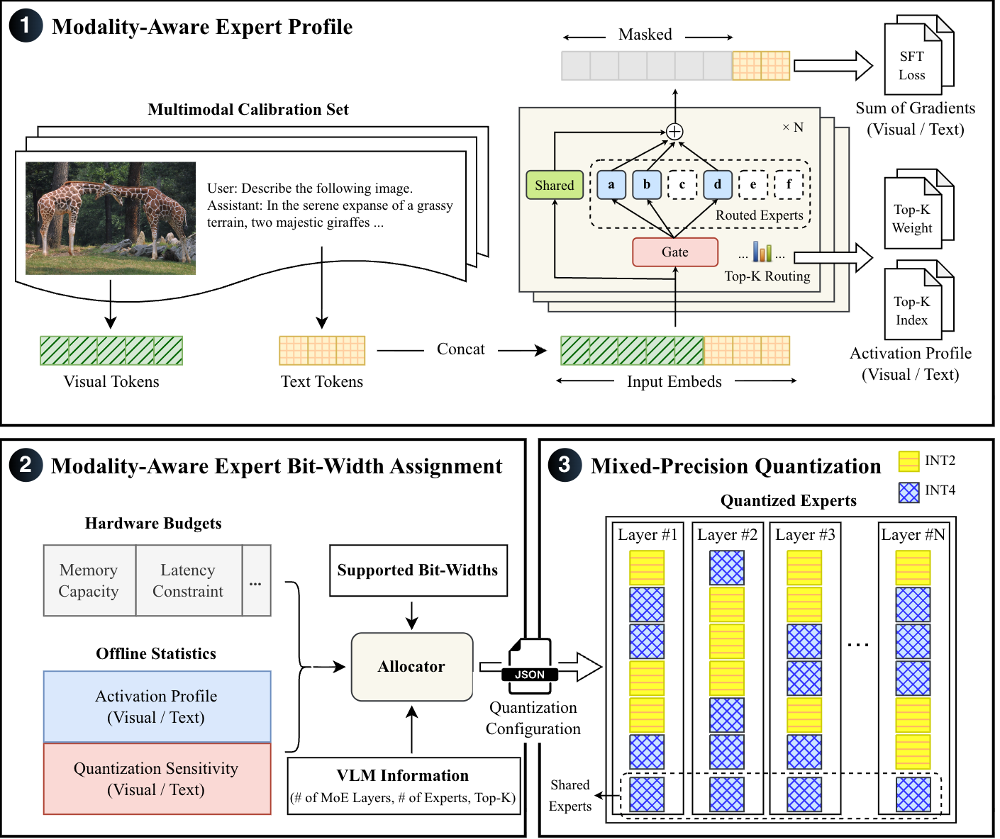

# MoMoVL: Modality-Aware Adaptive Compression for On-Device Sparsely-Activated Vision-Language Models
This repository contains the code and data for the following paper:
* [Dongkeun Lee](https://codongcodong.github.io/) and [Wonjun Lee](https://netlab.gachon.ac.kr/professors/wlee), “__MoMoVL: Modality-Aware Adaptive Compression for On-Device Sparsely-Activated Vision-Language Models__,” to appear in _the 20th ACM International Conference on Web Search and Data Mining_ (WSDM ’27) _Findings_, Hong Kong, China, February 2027.

Paper link (ACM DL) : [TBA]()      
Author preprint : [TBA]()

## Overview



## How to run this project

### 1. Init and sync uv
```
uv sync
```

### 2. Set environment variables

- Add below lines to .venv/bin/activate

```bash
export PROJECT_PATH="/path/to/this/project/"
# Directory where benchmark datasets will be stored (Defaults to /home/$USER/LMUData)
export LMUData="/path/to/LMUData/"
```

### 3. Test whether the project environment is properly set
```bash
source .venv/bin/activate
python ./test_scripts/test_env.py
```

### 4. Measure activation statistics and quantization sensitivity
```bash
# Requires GPU with more than 40GB VRAM for calibration on MolmoE-1B
python profile/profile_modality_statistics.py --model molmoe --num-samples 128
python profile/profile_modality_statistics.py --model deepseek --num-samples 128
```

### 5. Perform modality-aware bit-width assignment
```bash
# MoMoVL-Weight/Index on COCO128
python profile/generate_quant_config.py
```

### 6. Run MoMoVL
```bash
EVAL=$PROJECT_PATH/"vlmeval_run.py"
RES_DIR=$PROJECT_PATH/"vlmeval_results"
CONFIG_DIR=$PROJECT_PATH/"data/quant_config"
CALIB=COCO128

# Evaluate MolmoE-1B: MoMoVL-Weight/Index
for config in quant_modal_scale_sum_grad_weight quant_modal_scale_sum_grad_index
do
    python "$EVAL" --data MMMU_DEV_VAL MMBench_TEST_EN_V11 SEEDBench_IMG ScienceQA_TEST RealWorldQA MME-RealWorld-Lite AI2D_TEST OCRBench \
        --model molmoE-1B-0924 --work-dir "$RES_DIR"/quant_config/"$CALIB"/"$config" --quant-config "$CONFIG_DIR"/molmoe/"$config"_"$CALIB".json  \
        --verbose --mode all --judge exact_matching
done

# Evaluate DeepSeek-VL2-Tiny: MoMoVL-Weight/Index
for config in quant_modal_scale_sum_grad_weight quant_modal_scale_sum_grad_index
do
    python "$EVAL" --data MMMU_DEV_VAL MMBench_TEST_EN_V11 SEEDBench_IMG ScienceQA_TEST RealWorldQA MME-RealWorld-Lite AI2D_TEST OCRBench \
        --model deepseek_vl2_tiny --work-dir "$RES_DIR"/quant_config/"$CALIB"/"$config" --quant-config "$CONFIG_DIR"/deepseek/"$config"_"$CALIB".json  \
        --verbose --mode all --judge exact_matching
done
```

### 7. Run the baselines
```bash
EVAL=$PROJECT_PATH/"vlmeval_run.py"
RES_DIR=$PROJECT_PATH/"vlmeval_results"
CONFIG_DIR=$PROJECT_PATH/"data/quant_config"

# Uniform (Full-Model)
for model in molmoE-1B-0924 deepseek_vl2_tiny
do
    for quant_method in HQQ_8 HQQ_4
    do
        python "$EVAL" --data MMMU_DEV_VAL MMBench_TEST_EN_V11 SEEDBench_IMG ScienceQA_TEST RealWorldQA MME-RealWorld-Lite AI2D_TEST OCRBench \
            --model "$model" --work-dir "$RES_DIR"/"$quant_method" --quant-method "$quant_method"  \
            --verbose --mode all --judge exact_matching 
    done
done

# Uniform (Expert-Only)
for model in molmoE-1B-0924 deepseek_vl2_tiny
do
    # INT4
    python "$EVAL" --data MMMU_DEV_VAL MMBench_TEST_EN_V11 SEEDBench_IMG ScienceQA_TEST RealWorldQA MME-RealWorld-Lite AI2D_TEST OCRBench \
        --model "$model" --work-dir "$RES_DIR"/expert_int4 --quant-config "$CONFIG_DIR"/molmoe/quant_txt_top_p_COCO128.json --quant-level 100  \
        --verbose --mode all --judge exact_matching 
    # INT2
    python "$EVAL" --data MMMU_DEV_VAL MMBench_TEST_EN_V11 SEEDBench_IMG ScienceQA_TEST RealWorldQA MME-RealWorld-Lite AI2D_TEST OCRBench \
        --model "$model" --work-dir "$RES_DIR"/expert_int2 --quant-config "$CONFIG_DIR"/molmoe/quant_txt_top_p_COCO128.json --quant-level 0  \
        --verbose --mode all --judge exact_matching 
done

# MoE-APEX, Fate
for model in molmoE-1B-0924 deepseek_vl2_tiny
do
    for quant_method in APEX Fate
    do
        python "$EVAL" --data MMMU_DEV_VAL MMBench_TEST_EN_V11 SEEDBench_IMG ScienceQA_TEST RealWorldQA MME-RealWorld-Lite AI2D_TEST OCRBench \
            --model "$model" --work-dir "$RES_DIR"/"$quant_method" --quant-method "$quant_method"  \
            --verbose --mode all --judge exact_matching 
    done
done
```

## Contact
If you have any questions, please contact the author [Dongkeun Lee](https://codongcodong.github.io/).

## Citation
```
TBA
```

## License
The original code of this repository is released under the [MIT License](LICENSE).

This repository also includes third-party code, which remains under its original license:

| Component | Location in this repo | License |
| --- | --- | --- |
| [VLMEvalKit](https://github.com/open-compass/VLMEvalKit) | `vlmeval_run.py`, `vlmeval/` | [Apache-2.0](LICENSES/Apache-2.0-VLMEvalKit.txt) |
| [DeepSeek-VL2](https://github.com/deepseek-ai/DeepSeek-VL2) | `models/deepseek_vl2/`, `utils/deepseek_vl2/` | [MIT](LICENSES/MIT-DeepSeek-VL2.txt) (`modeling_deepseek*.py`: [Apache-2.0](LICENSES/Apache-2.0.txt)) |
| [MolmoE-1B](https://huggingface.co/allenai/MolmoE-1B-0924) | `models/molmoe/` | [Apache-2.0](LICENSES/Apache-2.0.txt) |
| [Hugging Face Transformers](https://github.com/huggingface/transformers) | `utils/molmoe/processing_utils.py` | [Apache-2.0](LICENSES/Apache-2.0-transformers.txt) |
| [Fate](https://github.com/FFFzy/Fate_open) | part of `utils/bitwidth.py` | [MIT](LICENSES/MIT-Fate.txt) |

Some of these files were modified for MoMoVL. See [THIRD_PARTY_NOTICES.md](THIRD_PARTY_NOTICES.md) for details.
